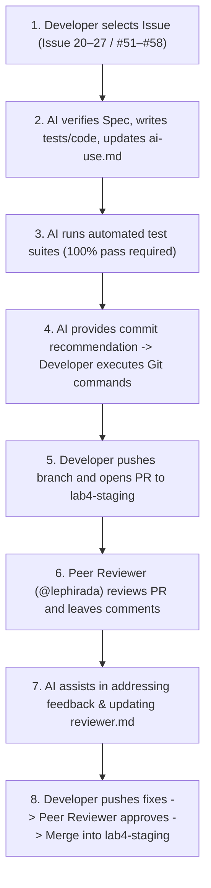

# TokTickIT Lab 4 — AI Collaboration Agreement & Engineering Protocol

This document establishes the collaboration agreement, core engineering rules, operational workflow, and design standards between the **Developer (@Phenwatsa)** and the **AI Coding Assistant (Antigravity)** throughout the development of TokTickIT Sprint 4 (Lab 4).

---

## 📌 Core Engineering Principles (11 Rules)

### Rule 1: Always Spec-First & Re-read Requirements
* Before beginning any task or issue, the AI must strictly consult the documentation in `docs/lab-04/`:
  - [`specification.md`](./specification.md) (Sprint Goals, Scope, FRs, BRs, ACs, DoD)
  - [`ui-spec.md`](./ui-spec.md) (Apple-style Zen Green design tokens, responsive breakpoints, visual checklist)
  - [`api-spec.md`](./api-spec.md) (REST contracts, JSON payloads, HTTP status codes, safe errors)
  - [`tests.md`](./tests.md) (Planned test table and AC traceability matrix)
  - [`issues-plan.md`](./issues-plan.md) (Issue scopes, branches, in/out-of-scope boundaries)
* **Never invent business rules or assume behaviors** without explicit user confirmation when ambiguities arise.

### Rule 2: Code Style & Architecture Consistency
* **Formatting**: Strict 2-space indentation, consistent curly bracket positioning, camelCase for functions/variables, PascalCase for React components, and strict TypeScript typings.
* **Section Headers**: Include clear header comments (e.g., `// ---------------------------------------------------------------------------`) with issue references.
* **Architecture**: Maintain clean modular code within `client/src/` and `server/src/` conforming to existing conventions.

### Rule 3: Strict Git Control (No Autonomous Git Execution)
* **The AI assistant is strictly prohibited from running git write commands autonomously** (`git add`, `git commit`, `git push`, `git pull`, `git checkout -b`, or branch creation).
* The AI will provide recommended commit messages following Conventional Commits (e.g., `docs(spec): ...`, `feat(actions-taken): ...`) and explicit CLI instructions for the developer to execute manually in their terminal.

### Rule 4: Issue & Branch Traceability
* Strictly follow the 8 GitHub Issues decomposition (Issue 20 (#51) through Issue 27 (#58)) with dedicated branches:
  1. `docs/lab4-spec-and-test-plan` (Issue 20 (#51): Spec DD & Test Plan)
  2. `feature/lab4-1-actions-taken-foundation` (Issue 21 (#52): DB Migration, Seed Data & Actions Taken API)
  3. `feature/lab4-2-ticket-workflow-enforcement` (Issue 22 (#53): Resolution Gate & Concurrency Enforcement)
  4. `feature/lab4-3-actions-taken-ui` (Issue 23 (#54): Actions Taken UI & Ticket Detail Integration)
  5. `feature/lab4-4-dashboard-apis` (Issue 24 (#55): Role Dashboard Metrics APIs)
  6. `feature/lab4-5-dashboard-ui` (Issue 25 (#56): Role Dashboards UI & Drill-Down)
  7. `feature/lab4-6-e2e-and-responsive` (Issue 26 (#57): Playwright E2E & Responsive Audit)
  8. `docs/lab4-documentation` (Issue 27 (#58): Final Docs, Reviewer Log & Release Integration)
* Complete one issue at a time. Do not jump across issues or combine multiple issues into a single branch.

### Rule 5: Zero Broken Tests & 100% Pass Policy
* Prior to reporting any implementation issue as complete, the AI must verify that:
  - All newly authored tests pass.
  - All previous regression tests from Labs 1, 2, and 3 continue to pass without regressions (`100% pass rate`).
  - The server and client builds compile with zero TypeScript diagnostics errors.

### Rule 6: Real-time Prompt Logging (`ai-use.md`)
* For every key architectural decision and major prompt instruction, the AI will assist in summarizing and appending entries to [`docs/lab-04/ai-use.md`](./ai-use.md) in real time.
* This ensures that 6–10 representative prompts with concrete outcomes are captured progressively throughout the sprint.

### Rule 7: Apple-Style Zen Green Design Standards
* Every user interface component must adhere to the **Apple-Style Zen Green Design System** specified in [`ui-spec.md`](./ui-spec.md):
  - Clean, uncluttered layout with generous whitespace.
  - Subtle drop shadows and delicate borders (`border-radius: 8px` to `12px`).
  - High-contrast typography with clear semantic hierarchy.
  - Smooth micro-interactions (transitions 150ms–200ms).
  - Minimum touch target of 44px for buttons and form controls.
  - Concise metric cards with labels, values, and accessible drill-down actions.

### Rule 8: Strict Simplicity / No Over-engineering (Excluded Items)
* The AI must strictly respect items explicitly excluded by the course specification:
  - NO automatic SLA clocks, escalation engines, on-call scheduling, or breach notifications.
  - NO email, SMS, LINE, push, or external notification services.
  - NO inventory consumption, spare parts, purchasing, or cost accounting.
  - NO time-sheet billing, payroll, or detailed labor-cost calculations.
  - NO multi-level approval workflows or electronic signatures.
  - NO advanced business-intelligence report builders or export warehouses.
  - NO multi-tenant organizations or production-scale cloud operations.

### Rule 9: Language & Communication Protocol
* **Pair Programming Discussions**: Thai language is used for collaborative discussions, planning, and explanations between the developer and AI.
* **Code, Artifacts & Documentation**: English is used strictly for all code, code comments, commit messages, PR descriptions, test assertions, and Markdown documentation files in `docs/lab-04/`.

### Rule 10: Code Stability & Non-Destructive Extension (Do NOT Touch Past Issues)
* **Completed Issues Are Frozen**: Once an issue is merged into `lab4-staging` (and all baseline code from Labs 1, 2, and 3), its implementation is locked.
* **No Unsolicited Refactoring**: The AI is **strictly prohibited from refactoring, modifying, rewriting, or deleting code, styles, or tests created in previous issues or previous labs** unless:
  1. The developer explicitly requests a specific change, OR
  2. A severe, blocking defect directly prevents the current issue from functioning or passing tests.
* **Additive Engineering**: New issues must build upon existing code through additive, non-destructive extensions rather than restructuring working code.

### Rule 11: PR Readiness & Justification Handover Protocol
* When the developer signals that an issue is complete and ready for commit/upload (e.g. *"Issue นี้เรียบร้อยไม่มีแก้"*), the AI must immediately deliver a complete Handover Package containing:
  1. **Strict Git CLI Commands**: Exact terminal commands to stage files, execute a Conventional Commit, and push the branch.
  2. **PR Title & PR Description**: Ready-to-copy Markdown summary detailing the changes, linked issue (`Closes #XX`), in-scope accomplishments, and verification evidence.
  3. **Verification & Justification Notes**: Clear justification points explaining what was done, what was intentionally deferred to successor issues (with rationale), and why any automated checking or peer reviewer should consider this issue fully passed within its defined scope without blocking on future dependencies or pending merge states.

---

## 🔄 Issue Development Workflow Diagram

